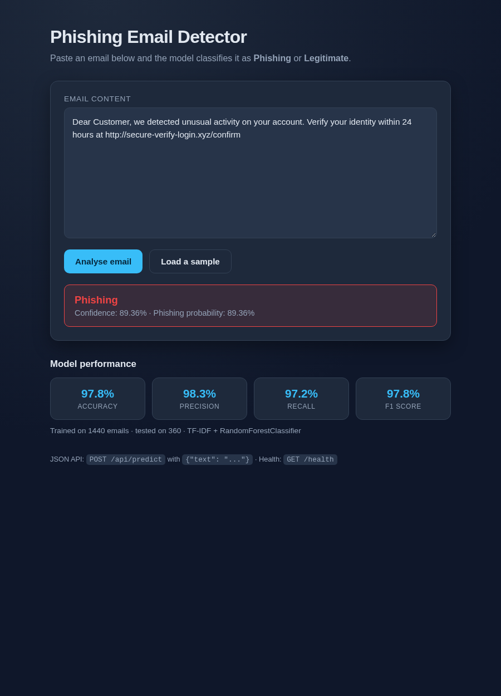

# Phishing Email Detection Using NLP

A machine-learning web app that classifies an email as **Phishing** or
**Legitimate** using **TF-IDF** vectorization and a **Random Forest**
classifier, served through a **Flask** application.

Built with Python, Flask, scikit-learn and classic Natural Language Processing.



---

## Highlights

- Classifies emails as phishing or legitimate using TF-IDF features (word +
  character n-grams) and a Random Forest classifier.
- Clean, reproducible pipeline: data generation → training → evaluation →
  Flask deployment.
- Interactive web UI plus a JSON API for programmatic / real-time predictions.
- Ships with a self-contained sample dataset, so it trains and runs fully
  offline with no downloads.
- Reports accuracy, precision, recall and F1 on a held-out test set (not just
  accuracy — see [Model performance](#model-performance)).

---

## Tech stack

| Layer            | Tools                                  |
| ---------------- | -------------------------------------- |
| Language         | Python 3.10+                           |
| ML / NLP         | scikit-learn, TF-IDF, Random Forest    |
| Data             | pandas, numpy                          |
| Web              | Flask, HTML, CSS, JavaScript           |
| Persistence      | joblib                                 |

---

## Project structure

```
phishing-email-detection/
├── app.py                     # Flask web app (UI + JSON API)
├── train_model.py             # Trains and evaluates the model
├── predict_cli.py             # Command-line predictor
├── requirements.txt           # Python dependencies
├── requirements-dev.txt       # Dev/test dependencies
├── data/
│   └── emails.csv             # Sample dataset (label, text)
├── model/                     # Trained model + metrics (generated)
│   ├── phishing_model.pkl
│   └── metrics.json
├── scripts/
│   └── generate_sample_data.py  # Creates the sample dataset
├── templates/
│   └── index.html             # Web UI
├── static/
│   └── style.css              # Styling
├── tests/
│   └── test_app.py            # Smoke tests for the app
├── .gitignore
└── LICENSE
```

---

## Getting started

### 1. Clone and enter the project

```bash
git clone https://github.com/<your-username>/phishing-email-detection.git
cd phishing-email-detection
```

### 2. Create a virtual environment (recommended)

```bash
# macOS / Linux
python -m venv .venv
source .venv/bin/activate

# Windows (PowerShell)
python -m venv .venv
.venv\Scripts\Activate.ps1
```

### 3. Install dependencies

```bash
pip install -r requirements.txt
```

### 4. Run the app

```bash
python app.py
```

Open **http://127.0.0.1:5000** in your browser. If the model has not been
trained yet, the app trains it automatically on first start.

That's it — paste an email and get a verdict.

---

## Training the model manually

To (re)train and see the full evaluation report:

```bash
python scripts/generate_sample_data.py   # only if data/emails.csv is missing
python train_model.py
```

This writes `model/phishing_model.pkl` and `model/metrics.json`.

---

## Using the JSON API

```bash
curl -X POST http://127.0.0.1:5000/api/predict \
  -H "Content-Type: application/json" \
  -d '{"text": "Urgent: verify your account at http://secure-login.xyz"}'
```
Response:

```json
{
  "label": "Phishing",
  "is_phishing": true,
  "confidence": 98.4,
  "phishing_probability": 98.4
}
```

| Endpoint            | Method | Purpose                          |
| ------------------- | ------ | -------------------------------- |
| `/`                 | GET    | Web UI                           |
| `/predict`          | POST   | Form-based prediction            |
| `/api/predict`      | POST   | JSON prediction (`{"text": ...}`)|
| `/health`           | GET    | Health check                     |

---

## Command-line usage

```bash
python predict_cli.py "Your account has been suspended, verify now at http://x.xyz"
```

---

## Running the tests

```bash
pip install -r requirements-dev.txt
pytest -q
```

---

## How it works

1. **Text preparation** — the subject and body are combined into one text field.
2. **Feature extraction (TF-IDF)** — `TfidfVectorizer` converts text into
   weighted n-gram features. Word n-grams (`1–2`) capture phrases such as
   *"verify your account"*, while the model also benefits from character-level
   signal in unusual URLs and obfuscated tokens.
3. **Classification** — a `RandomForestClassifier` (300 trees) predicts the
   probability that an email is phishing.
4. **Serving** — Flask exposes the trained pipeline through a web UI and a
   JSON API. The whole pipeline is saved with `joblib`, so training and serving
   stay consistent.

---

## Model performance

Metrics are written to `model/metrics.json` on each training run. Because
phishing datasets are class-imbalanced, the project reports precision, recall
and F1 for the phishing class alongside accuracy. Run `python train_model.py`
to regenerate them on your machine.

> **Note:** the bundled dataset is a small synthetic sample for demonstration.
> Real-world accuracy depends on the training corpus — swap in a public dataset
> (see below) to train a production-grade model.

---

## Using a real dataset

Replace `data/emails.csv` with any corpus that has two columns, `label`
(`1` = phishing, `0` = legitimate) and `text`. Public options:

- Enron-Spam dataset
- SpamAssassin public corpus
- Nazario phishing corpus
- Kaggle — "Phishing Email Detection"

Then re-run `python train_model.py`.

---

## Roadmap / possible extensions

- Add character n-gram-only and Linear SVM / Logistic Regression baselines and
  compare F1.
- Explainability: surface the top TF-IDF terms that drove each prediction.
- URL-level feature extraction (domain age, mismatched anchors, IP-based links).
- Dockerfile and a deploy config for a hosted demo.

---

## License

Released under the [MIT License](LICENSE).

## Author

**Sunny Gouria**
